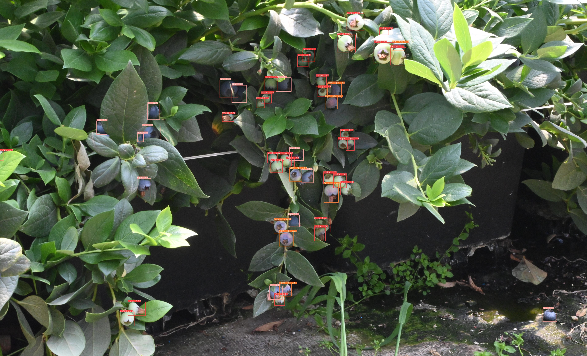

#                                     DCS-YOLO

Our model is implemented based on the Ultralytics framework. For detailed installation instructions, please visit https://github.com/ultralytics/ultralytics.
If you have any questions about this project, please feel free to contact me via GitHub.

## Demo

## Datesets
Dataset：
Link: https://pan.baidu.com/s/18KPmKmHvQuUMLJQjQPFB_A?pwd=rnya Download code: rnya 
## If you are interested in our dataset work, please cite the following.
### [1]. DCS-YOLO: A blueberry maturity detection model in complex environments
title = {DCS-YOLO: A blueberry maturity detection model in complex environments},
journal = {Computers and Electronics in Agriculture},
volume = {248},
pages = {111830},
year = {2026},
issn = {0168-1699},
doi = {https://doi.org/10.1016/j.compag.2026.111830},
author = {Chengbiao Fu and Aiping Wang and Anhong Tian},
}
### [2]. A visual detection method for blueberries with different ripeness in a complex orchard environment
@article{FU2026114963,
title = {A visual detection method for blueberries with different ripeness in a complex orchard environment},
journal = {Engineering Applications of Artificial Intelligence},
volume = {177},
pages = {114963},
year = {2026},
issn = {0952-1976},
doi = {https://doi.org/10.1016/j.engappai.2026.114963},
author = {Chengbiao Fu and Fan Chen and Anhong Tian},
}

